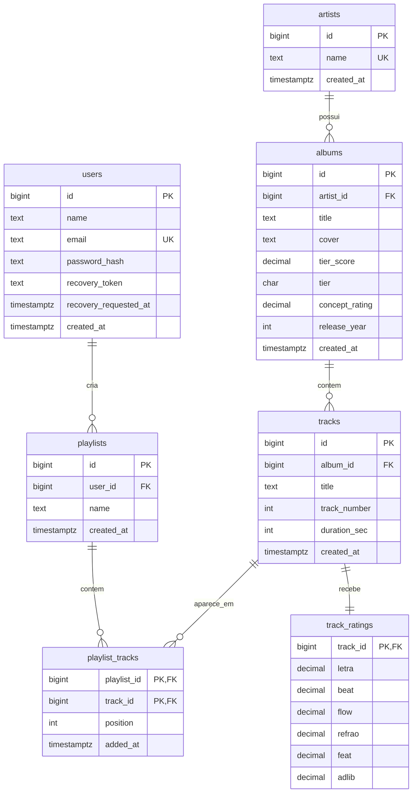

# Banco de Dados - MusiCave

Esta pasta concentra tudo que pertence ao banco de dados do MusiCave.

## Arquivos

- `schema.sql`: estado final e completo do banco.
- `seed.sql`: dados iniciais para demonstracao.
- `verification.sql`: consultas para conferir se o banco foi criado corretamente.
- `migrations/`: historico organizado da evolucao do banco.

## Modelo Entidade-Relacionamento



## Cardinalidades

- Um artista pode ter varios albuns.
- Um album pertence a um artista.
- Um album possui varias faixas.
- Uma faixa pertence a um album.
- Uma faixa possui uma avaliacao detalhada.
- Um usuario pode criar varias playlists.
- Uma playlist pode ter varias faixas.
- Uma faixa pode aparecer em varias playlists.

## Regras de Integridade

- Emails nao podem se repetir, incluindo variacoes de maiusculas/minusculas.
- Nomes de artistas nao podem se repetir, incluindo variacoes de maiusculas/minusculas.
- Um artista nao pode ter dois albuns com o mesmo titulo.
- Um album nao pode ter duas faixas com o mesmo `track_number`.
- Campos obrigatorios nao aceitam texto em branco.
- Notas devem estar entre `0` e `10`.
- `tier` so pode ser `S`, `A`, `B`, `C` ou `D`.
- `track_number`, `duration_sec` e posicao em playlist devem ser positivos.
- Ao remover um album, suas faixas e avaliacoes sao removidas por cascata.
- Ao remover um usuario, suas playlists sao removidas por cascata.

## Tabelas

### users

Guarda os usuarios do sistema. A senha e salva em `password_hash`, nunca em texto puro.

### artists

Guarda os artistas. O nome e unico de forma case-insensitive.

### albums

Guarda albuns avaliados, artista, capa, conceito, nota final e tier.

### tracks

Guarda as faixas de cada album. O campo `track_number` representa a ordem da faixa.

### track_ratings

Guarda as notas detalhadas de cada faixa: letra, beat, flow, refrao, feat e adlib.

### playlists

Guarda playlists criadas por usuarios.

### playlist_tracks

Tabela de relacionamento N:N entre playlists e faixas.

## Dados De Teste

O `seed.sql` cria:

- usuario `teste@musicave.local`
- senha `musicave123`
- artistas Daft Punk, Travis Scott e Kendrick Lamar
- albuns Discovery, ASTROWORLD e DAMN.
- faixas avaliadas
- playlist de exemplo

## Como Conferir No Adminer

1. Rode o banco:

```bash
docker-compose up -d
```

2. Abra:

```text
http://localhost:8080
```

3. Use:

```text
Sistema: PostgreSQL
Servidor: db
Usuario: musicave
Senha: musicave
Banco: musicave
```

4. Execute as consultas de `verification.sql`.

## Checklist Da Parte De Banco

- [x] Estrutura normalizada por entidades principais.
- [x] Chaves primarias e estrangeiras.
- [x] Relacionamentos 1:N e N:N.
- [x] Regras de notas e tiers com `CHECK`.
- [x] Indices para consultas e unicidade.
- [x] Ordem das faixas no album.
- [x] Seed com dados demonstraveis.
- [x] Migrations organizadas.
- [x] Documentacao e DER.
